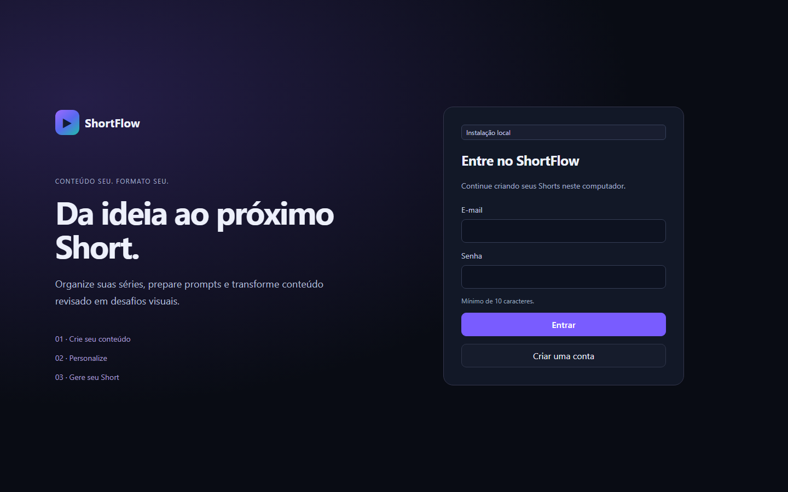
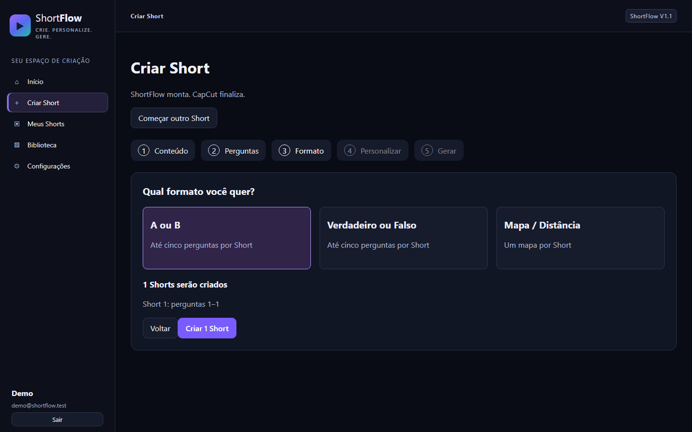
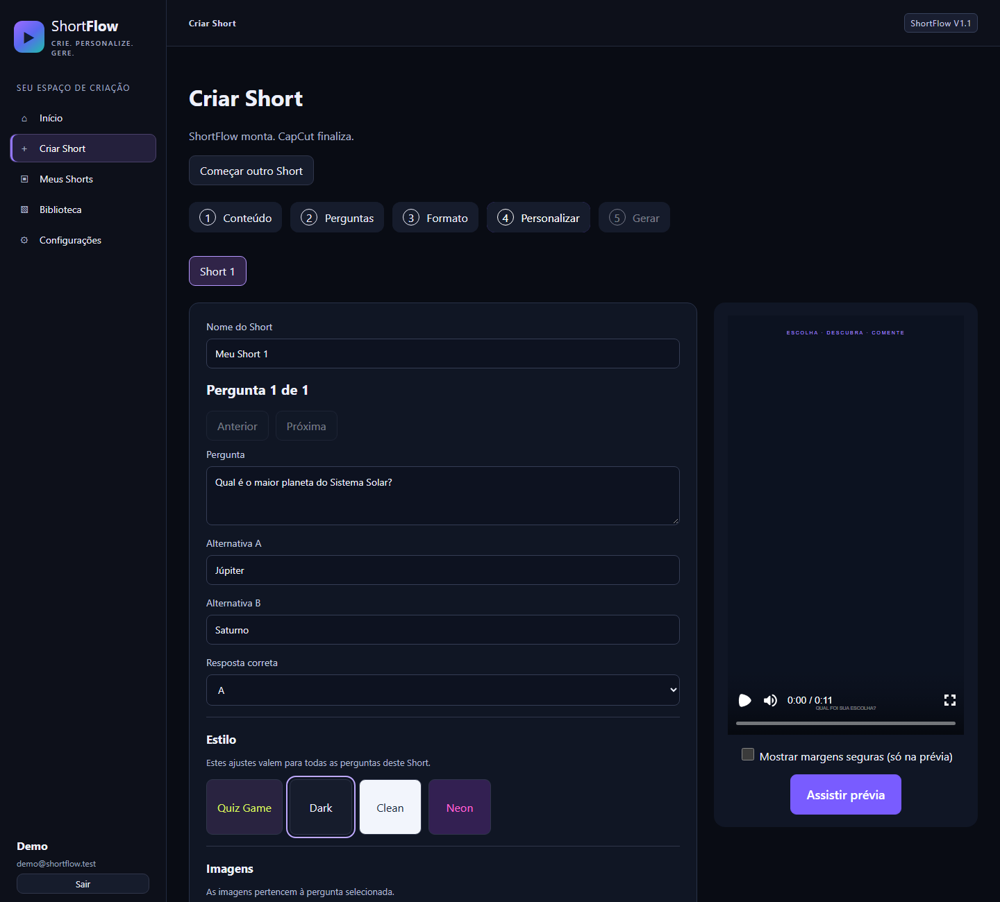
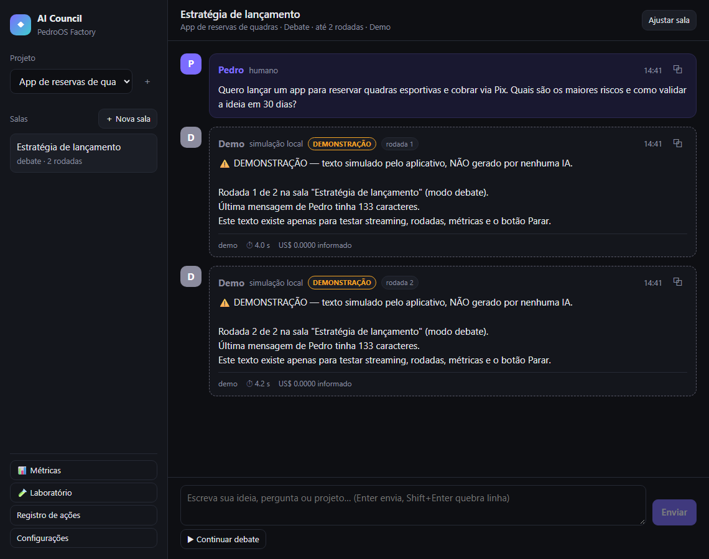
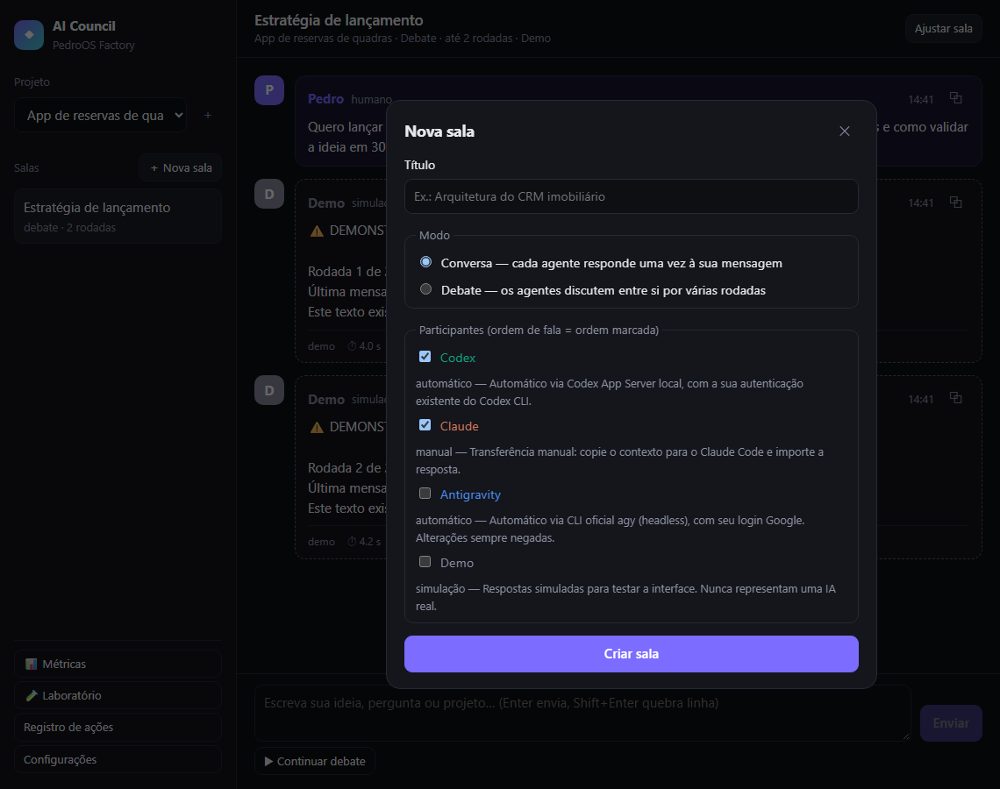
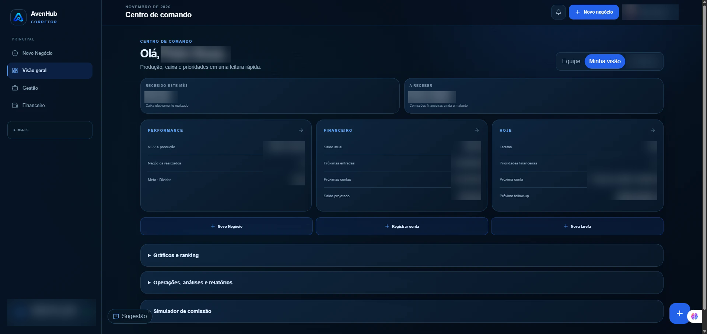
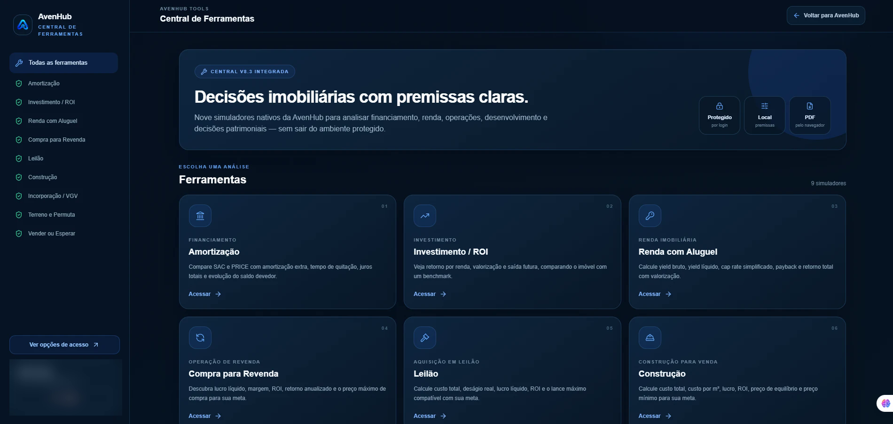

# Olá, eu sou o Pedro Henrique Souza 👋

**Empreendedor · Corretor de imóveis · Gestor financeiro · Desenvolvedor em evolução**

Construo SaaS, automações e ferramentas com IA para resolver problemas reais de negócio —
especialmente nos mercados imobiliário, financeiro e esportivo.

---

## 🧭 Sobre mim

- 🎓 Formado em **Gestão Financeira** e atuando como **corretor de imóveis** — conheço por dentro os processos que automatizo.
- 🤖 Foco em **IA aplicada**, **automações** e **produtos digitais** que geram resultado prático.
- 🛠️ Desenvolvo com apoio de agentes de IA (Claude Code e Codex), com atenção a segurança, testes e documentação.
- 🚀 Mentalidade de dono: *resolvo problemas e executo.*

---

## 🧰 Stack

| Área | Tecnologias |
|---|---|
| **Linguagens** | TypeScript, JavaScript, SQL |
| **Front-end** | React, Next.js, Vite, Tailwind CSS, Radix UI, TanStack Query, Framer Motion, Recharts |
| **Back-end** | Node.js, Express, Zod, OpenAPI (Orval) |
| **Dados** | PostgreSQL, SQLite, Cloudflare D1, Drizzle ORM |
| **Autenticação e pagamentos** | Clerk, NextAuth (Google), Pix via Mercado Pago, Kiwify |
| **Vídeo** | Remotion, FFmpeg |
| **Infra e deploy** | Vercel, Cloudflare Workers, Replit |
| **IA e agentes** | Claude Code, Codex CLI |

---

## 🚀 Projetos

> Meus produtos estão em operação ou em desenvolvimento ativo, por isso o código-fonte é privado.
> Aqui está a ideia, a essência e telas reais de cada um.

### 🎬 ShortFlow — da ideia ao próximo Short

**A ideia:** criar vídeos curtos de quiz e curiosidades leva tempo demais em editores comuns. O ShortFlow transforma perguntas e respostas em Shorts verticais prontos, em poucos minutos.

**A essência:**
- Assistente em 5 passos: conteúdo → perguntas → formato → personalização → geração.
- Formatos **A ou B**, **Verdadeiro ou Falso** e **Mapa / Distância**, com estilos visuais prontos.
- Conteúdo criado manualmente, importado por JSON/CSV ou preparado com prompts para IA.
- Exportação em **MP4** renderizada localmente, sem APIs pagas.

  

  
  

`TypeScript` `React` `Remotion` `Node.js` `Express` `SQLite`

---

### 🏗️ AI Council — várias IAs pensando juntas

**A ideia:** comparar a opinião de diferentes IAs exige copiar e colar entre ferramentas. O AI Council reúne pessoa e agentes de IA numa mesma sala para analisar uma ideia.

**A essência:**
- Salas em modo **conversa** ou **debate**, com ordem de fala e limite de rodadas.
- Integra **Codex**, **Claude** e **Google Antigravity**.
- Métricas de tokens, tempo e custo por mensagem, e laboratório para comparar prompts.
- Roda só no computador do usuário: sem hospedagem e sem guardar senhas ou tokens.

  
  

`TypeScript` `React` `Node.js` `Codex CLI` `Claude Code`

---

### 🏆 PlayHub — onde o jogo acontece

**A ideia:** organizar uma partida de futebol amador envolve grupo de mensagens, planilha e cobrança manual. O PlayHub junta tudo em uma plataforma.

**A essência:**
- Perfis de **jogador**, **organizador** e **arena**.
- Página pública da partida para confirmar presença.
- Arenas parceiras com quadras, fotos e agenda de horários.
- Cobrança via **Pix** pelo Mercado Pago, com confirmação automática do pagamento.

`TypeScript` `React` `Express` `PostgreSQL` `Drizzle` `Clerk` `Mercado Pago`

---

### 💼 AvenHub — gestão de comissões imobiliárias

**A ideia:** corretores e imobiliárias controlam vendas, comissões e recebimentos em planilhas soltas. O AvenHub organiza produção, finanças e metas num só painel.

**A essência:**
- Produção por venda e angariação, separada do financeiro.
- Recebimentos parciais, auditoria e lixeira com restauração.
- Metas, processo diário e orientação financeira.
- Experiências para corretor, imobiliária, finanças pessoais e empresa.
- Central com 9 simuladores imobiliários: amortização, ROI, aluguel, revenda, leilão, construção e mais.

  

  

`Next.js` `React` `Cloudflare Workers` `D1` `Drizzle` `NextAuth` `Zod`

---

## 💡 Competências

- **Produto e negócio** — transformo dores do dia a dia (comissões, finanças, vendas, conteúdo) em software.
- **Gestão financeira** — modelagem de comissões, recebimentos, metas e indicadores.
- **Mercado imobiliário** — processos de venda, angariação e gestão de carteira.
- **Desenvolvimento full-stack** — do banco de dados à interface responsiva.
- **Automação e IA** — fluxos com agentes de IA, geração de conteúdo e ferramentas internas.
- **Segurança e boas práticas** — autenticação, controle de acesso, auditoria e idempotência em pagamentos.

---

## 📫 Contato

*"Resolvo problemas e executo."*

